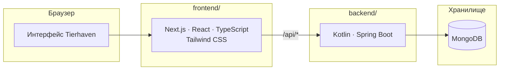

<picture>
  <source media="(prefers-color-scheme: dark)" srcset="docs/branding/tierhaven-mark-paper.svg">
  
</picture>

# Tierhaven

**Тир-листы по общим шаблонам и сравнение вкусов**

Целевой стек

---

## О проекте

Tierhaven — учебное веб-приложение: пользователь создаёт шаблон с набором объектов, распределяет их по тирам и делится своим списком. Compare сопоставляет два списка одного шаблона: показывает процент совпадения, различия и пять самых спорных объектов.

Сейчас в репозитории подготовлен скелет: `backend/`, `frontend/` и `docs/`. Приложения и зависимости ещё не инициализированы.

## Архитектура

Целевая схема: браузер обращается к Next.js, который проксирует API-запросы в Spring Boot. Бизнес-логика и доступ к данным принадлежат backend.

Требования, контракты и план реализации — в [спецификации](docs/SPEC.md).

## Локальная разработка

Команд запуска пока нет. Backend планируется на Kotlin и Spring Boot, frontend — на Next.js с Bun и Biome, локальная MongoDB — в Docker Compose. Версии и команды будут зафиксированы в конфигурации приложений при их инициализации.
