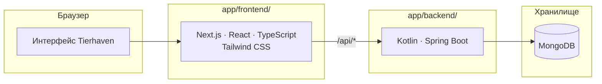

# Tierhaven

**Тир-листы по общим шаблонам и сравнение вкусов**

Целевой стек

---

## О проекте

Tierhaven — учебное веб-приложение: пользователь создаёт шаблон с набором объектов, распределяет их по тирам и делится своим списком. Compare сопоставляет два списка одного шаблона: показывает процент совпадения, различия и пять самых спорных объектов.

В репозитории подготовлены структура проекта и локальная MongoDB в Docker Compose. В `app/backend` инициализировано приложение Spring Boot; `app/frontend` пока содержит заготовку для frontend.

## Архитектура

Целевая схема: браузер обращается к Next.js, который проксирует API-запросы в Spring Boot. Бизнес-логика и доступ к данным принадлежат backend.

Требования, контракты и план реализации — в [спецификации](docs/SPEC.md).

## Локальная разработка

Для локальной разработки доступна MongoDB 8.0 в Docker Compose. Требования к окружению, запуск, проверка состояния и остановка описаны в [руководстве по локальной разработке](docs/local-development.md).
