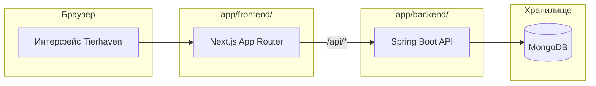

<div align="center">

# Tierhaven — спецификация


</div>

Требования к продукту и план реализации. Сейчас подготовлен скелет репозитория; архитектура, API, команды и задачи ниже описывают целевое состояние.

<div align="center">

## 1. Обзор

</div>

Tierhaven — веб-приложение для тир-листов, где главная ценность не сам список, а **сравнение вкусов**: насколько твой рейтинг совпадает с чужим и где именно вы расходитесь.

Пользователь создаёт **шаблон** (тема + набор объектов), по нему любой человек собирает **свой тир-лист** через drag-and-drop, а два списка по одному шаблону можно **сравнить**: процент совпадения, diff и самые спорные объекты.

**Цель проекта — учебная.** Это тренировочный пет-проект, чтобы:

- писать ключевую логику руками и понимать каждую строку;
- осознанно пользоваться AI для бойлерплейта и ревью;
- освоить стек: Kotlin + Spring Boot, MongoDB, Next.js + TypeScript + Tailwind, Docker.

**Принципы, которые нельзя нарушать:**

1. **Минимальный скоуп.** Делается только то, что описано в текущей фазе. Идеи на потом идут в раздел «Открытые вопросы» или в эпики M4+.
2. **Вертикальные срезы.** Фронт не откладывается на потом: после backend-MVP сразу идёт frontend-MVP, потом Compare на обеих сторонах.
3. **Одна задача — один PR — 1–4 часа.** Если задача больше, она дробится.
4. **Каждая задача имеет режим** `hand` / `ai-assisted` / `ai` (раздел 12) и критерии приёмки.
5. **Тесты пишутся для логики**, а не для галочки: валидатор инварианта, расчёт match, редьюсер редактора.
6. **Без overengineering:** никаких микросервисов, CQRS, Kafka, Redis, Zustand и прочего, пока конкретная задача этого не требует.

<div align="center">

## 2. Главная фича — Compare

</div>

Compare отличает Tierhaven от обычных конструкторов тир-листов: список не заканчивается скриншотом, его кладут рядом с чужим.

Что видит пользователь на странице сравнения двух списков:

- **Taste match** — процент совпадения вкусов, например 87%.
- **Diff-таблица** — каждый общий объект, его тир у A и у B, разница. Совпадения приглушены, расхождения подсвечены.
- **Самые спорные** — топ-5 объектов с наибольшей разницей: «Skyrim: у тебя S, у Алекса C».
- **Призыв к действию** — «Сделай свой список по этому шаблону и сравни».

Почему именно эта фича:

- работает уже с **двумя** пользователями, поэтому нет проблемы холодного старта, как у рейтингов сообщества;
- естественно вирусная: ссылка «сравни со мной» сама приводит нового пользователя;
- технически простая для MVP: чистая функция над двумя документами, без ML и без сложных запросов.

Обязательное условие: сравнивать можно только списки **одного шаблона**, потому что нужны общие id объектов. Поэтому шаблоны — фундамент всей модели данных.

<div align="center">

## 3. Глоссарий

</div>

Эти термины используются одинаково в коде, API, UI и задачах Linear. Имена в коде — из колонки «В коде».

<table align="center">
  <thead>
    <tr><th align="center" valign="middle">Термин</th><th align="center" valign="middle">В коде</th><th align="center" valign="middle">Значение</th></tr>
  </thead>
  <tbody>
    <tr><td align="center" valign="middle">Шаблон</td><td align="center" valign="middle"><code>Template</code></td><td align="center" valign="middle">Тема + набор объектов + тиры по умолчанию. Общий для всех, кто делает по нему список</td></tr>
    <tr><td align="center" valign="middle">Объект</td><td align="center" valign="middle"><code>Item</code></td><td align="center" valign="middle">Элемент шаблона: название, картинка (URL), описание. Имеет стабильный <code>id</code></td></tr>
    <tr><td align="center" valign="middle">Тир-лист</td><td align="center" valign="middle"><code>TierList</code></td><td align="center" valign="middle">Личный рейтинг одного человека по одному шаблону</td></tr>
    <tr><td align="center" valign="middle">Тир</td><td align="center" valign="middle"><code>Tier</code></td><td align="center" valign="middle">Уровень в тир-листе: имя, цвет, упорядоченный список объектов</td></tr>
    <tr><td align="center" valign="middle">Пул</td><td align="center" valign="middle"><code>unrankedItemIds</code></td><td align="center" valign="middle">Объекты шаблона, ещё не размещённые ни в одном тире</td></tr>
    <tr><td align="center" valign="middle">Размещение</td><td align="center" valign="middle">placement</td><td align="center" valign="middle">Факт «объект X лежит в тире Y на позиции N»</td></tr>
    <tr><td align="center" valign="middle">Токен редактирования</td><td align="center" valign="middle"><code>editToken</code></td><td align="center" valign="middle">Секрет, дающий право менять шаблон или список. Выдаётся один раз при создании</td></tr>
    <tr><td align="center" valign="middle">Совпадение</td><td align="center" valign="middle"><code>match</code></td><td align="center" valign="middle">Процент сходства двух тир-листов одного шаблона, 0–100</td></tr>
    <tr><td align="center" valign="middle">Спорный объект</td><td align="center" valign="middle">controversial item</td><td align="center" valign="middle">Объект с наибольшей разницей позиций в двух списках</td></tr>
    <tr><td align="center" valign="middle">Архивный объект</td><td align="center" valign="middle"><code>archived = true</code></td><td align="center" valign="middle">Объект, удалённый из шаблона мягко: скрыт и не участвует в сравнении</td></tr>
  </tbody>
</table>

<div align="center">

## 4. Пользовательские сценарии

</div>

В MVP нет аккаунтов: право на редактирование подтверждает `editToken` в localStorage браузера автора.

**US-1. Создать шаблон.** Я ввожу название, категорию, описание, добавляю 2–100 объектов (название, необязательно URL картинки) и при желании меняю тиры по умолчанию. После сохранения попадаю на страницу шаблона, а токен сохраняется в моём браузере.

**US-2. Отредактировать шаблон.** Как автор, я могу менять метаданные, добавлять и переименовывать объекты, архивировать объекты. Удалить объект «жёстко» нельзя: он может быть в чужих списках.

**US-3. Сделать свой тир-лист по шаблону.** На странице шаблона жму «Сделать свой». Создаётся список, где все объекты лежат в пуле, а тиры скопированы из шаблона. Я открываю редактор.

**US-4. Распределить объекты.** Перетаскиваю объекты из пула в тиры, между тирами, меняю порядок внутри тира, возвращаю обратно в пул. Работает мышью и на тачскрине.

**US-5. Настроить тиры.** Переименовываю, перекрашиваю, добавляю, удаляю (объекты удалённого тира возвращаются в пул) и меняю порядок тиров. Тиров от 2 до 10.

**US-6. Сохранить.** Жму «Сохранить». Вижу индикатор несохранённых изменений. Если список изменили в другой вкладке, получаю понятное сообщение и предложение перезагрузить.

**US-7. Поделиться.** Копирую ссылку на список. Тот, у кого нет токена, видит список только для чтения.

**US-8. Сравнить.** На чужом списке жму «Сравнить со мной», выбираю свой список по тому же шаблону и вижу match, diff и спорные объекты. Если своего списка нет — кнопка «Сделать свой по этому шаблону».

**US-9. Найти шаблоны.** На главной вижу последние шаблоны, на странице шаблона — все списки, сделанные по нему.

<div align="center">

## 5. Скоуп по фазам

</div>

Детально расписаны только M0–M3: это рабочий продукт с главной фичей. M4+ — эпики-заглушки, их дробят на задачи только после завершения M3.

1. **M0 — Setup.** Монорепо, Docker Compose с MongoDB, пустые backend и frontend, CI, обработка ошибок, утилита токенов. Итог: `docker compose up` + оба приложения стартуют, health-check зелёный.
2. **M1 — Backend MVP.** CRUD шаблонов и тир-листов, валидатор инварианта, optimistic locking, OpenAPI. Итог: весь сценарий US-1…US-7 проходит через HTTP-запросы.
3. **M2 — Frontend MVP.** Страницы, форма шаблона, редактор с drag-and-drop, сохранение, просмотр. Итог: US-1…US-7 и US-9 проходят в браузере.
4. **M3 — Compare.** Расчёт match, эндпоинт сравнения, страница сравнения, кнопка «Сравнить со мной». Итог: US-8 проходит в браузере. **Это точка, где проект уже можно показывать.**
5. **M4 — Деплой.** Публичный URL, managed MongoDB, переменные окружения.
6. **M5 — Аккаунты.** Вход, «мои списки», привязка старых списков по токену, публичные/приватные.
7. **M6 — Сообщество.** Усреднённый тир-лист по шаблону, «ты против всех».
8. **M7 — Соцфичи.** Подписки, «люди с похожим вкусом», лайки.
9. **M8 — Режим «это или то».** Список строится через попарный выбор (Elo).
10. **M9 — Загрузка картинок.** S3-совместимое хранилище вместо URL.

**Out of scope для M0–M3 (не делать, даже если «быстро»):**

- авторизация, пользователи, профили;
- загрузка файлов — только URL картинки;
- свои объекты внутри списка, которых нет в шаблоне;
- экспорт тир-листа в картинку;
- поиск по шаблонам (только «последние» с пагинацией);
- комментарии, лайки, уведомления;
- автосохранение (только кнопка «Сохранить»);
- i18n — интерфейс только на русском;
- realtime-совместное редактирование.

<div align="center">

## 6. Архитектура

</div>

Монолит из двух приложений в одном репозитории: Next.js отдаёт UI и проксирует `/api/*` в Spring Boot, Spring Boot работает с MongoDB. Браузер ходит только на Next.js, поэтому CORS не нужен.



Вся логика (инвариант, match) живёт в Spring Boot; Next.js не обращается к MongoDB напрямую.

**Целевой стек.** Версии выбираются при инициализации приложений после проверки совместимости и фиксируются в manifests и lock-файлах. Для frontend приняты Bun и Biome; ESLint и Prettier не подключаются.

<table align="center">
  <thead>
    <tr><th align="center" valign="middle">Слой</th><th align="center" valign="middle">Технологии</th></tr>
  </thead>
  <tbody>
    <tr><td align="center" valign="middle">Backend</td><td align="center" valign="middle">Kotlin, Spring Boot (Web, Data MongoDB, Validation, Actuator), Gradle Kotlin DSL, актуальный LTS JDK</td></tr>
    <tr><td align="center" valign="middle">Документация API</td><td align="center" valign="middle">springdoc-openapi (совместимая со Spring Boot версия)</td></tr>
    <tr><td align="center" valign="middle">БД</td><td align="center" valign="middle">MongoDB в Docker, в проде — managed (M4)</td></tr>
    <tr><td align="center" valign="middle">Frontend</td><td align="center" valign="middle">Next.js (App Router), React, TypeScript strict + noUncheckedIndexedAccess, Tailwind CSS, dnd-kit</td></tr>
    <tr><td align="center" valign="middle">Инструменты frontend</td><td align="center" valign="middle">Bun, bun.lock; Biome для lint и форматирования</td></tr>
    <tr><td align="center" valign="middle">Типы API на фронте</td><td align="center" valign="middle">openapi-typescript, генерация из спеки backend</td></tr>
    <tr><td align="center" valign="middle">Тесты backend</td><td align="center" valign="middle">JUnit 5, Testcontainers (MongoDB), MockMvc</td></tr>
    <tr><td align="center" valign="middle">Тесты frontend</td><td align="center" valign="middle">Vitest для логики; Playwright — один e2e happy path в конце M2</td></tr>
    <tr><td align="center" valign="middle">Инфраструктура</td><td align="center" valign="middle">Docker Compose, GitHub Actions</td></tr>
  </tbody>
</table>

**Целевая структура репозитория:**

```text
web.Tierhaven/
├── app/
│   ├── backend/
│   │   ├── build.gradle.kts
│   │   └── src/main/kotlin/app/tierhaven/
│   │       ├── TierhavenApplication.kt
│   │       ├── common/          # ошибки, ProblemDetail, токены, id-генерация
│   │       ├── template/        # Template: document, repository, service, controller, dto
│   │       ├── tierlist/        # TierList: то же + PlacementValidator
│   │       └── compare/         # MatchCalculator (чистый Kotlin), CompareService, controller
│   └── frontend/
│       └── src/
│           ├── app/             # маршруты App Router
│           ├── components/      # ui/ (Button, Input…) + feature-компоненты
│           ├── features/
│           │   ├── template/
│           │   ├── tierlist/    # editorReducer.ts + тесты
│           │   └── compare/
│           └── lib/             # api-клиент, сгенерированные типы, tokenStorage
├── docs/
│   ├── SPEC.md              # этот документ
│   ├── postman/             # коллекция появится в T-009
│   ├── branding/            # знак для документации
│   └── AI/                  # общие инструкции и router
├── docker-compose.yml
├── .env.example
├── .editorconfig
├── .gitignore
├── AGENTS.md                # ссылка на docs/AI/
└── README.md
```

**Правила backend:**

- пакеты по фичам, внутри слои `controller → service → repository`;
- контроллер не трогает репозиторий напрямую и не содержит логики;
- `@Document`-классы никогда не отдаются наружу: всегда DTO + маппер как extension-функция `fun Template.toResponse()`;
- бизнес-правила (инвариант, match) — чистые классы без Spring, чтобы тестировать без контекста;
- ошибки — через исключения доменного уровня и один `@RestControllerAdvice`.

**Правила frontend:**

- страницы только для чтения — серверные компоненты, данные грузятся на сервере;
- редактор — клиентский компонент, состояние в `useReducer`; глобальный стор не нужен;
- все запросы — через один модуль `lib/api.ts`, никаких `fetch` в компонентах;
- localStorage — только через обёртку `lib/tokenStorage.ts` с try/catch.
- зависимости устанавливаются через Bun; для frontend хранится один `bun.lock`, версия Bun закрепляется в `packageManager` при T-006;
- lint и форматирование выполняются Biome; параллельные ESLint/Prettier-конфиги не создаются;
- Vitest запускается через `bun run test`: команда `bun test` относится к встроенному раннеру Bun и не заменяет этот скрипт.

<div align="center">

## 7. Модель данных (MongoDB)

</div>

Две коллекции: `templates` и `tier_lists`. Шаблон и список — отдельные агрегаты, каждый читается и сохраняется целиком. Объекты хранятся только в шаблоне, список ссылается на них по `id`.

**Коллекция `templates`:**

```json
{
  "_id": "ObjectId",
  "title": "Игры 2020-х",
  "category": "games",
  "description": "Главные игры десятилетия",
  "items": [
    { "id": "itm_8f3k2a", "name": "Elden Ring", "imageUrl": "https://…", "description": null, "archived": false }
  ],
  "defaultTiers": [
    { "id": "tr_s", "name": "S", "color": "#FF7F7F" }
  ],
  "editTokenHash": "sha256-hex",
  "createdAt": "ISODate",
  "updatedAt": "ISODate",
  "version": 0
}
```

**Коллекция `tier_lists`:**

```json
{
  "_id": "ObjectId",
  "templateId": "ObjectId шаблона",
  "title": "Мой топ игр",
  "authorName": "Стас",
  "tiers": [
    { "id": "tr_s", "name": "S", "color": "#FF7F7F", "itemIds": ["itm_8f3k2a"] }
  ],
  "unrankedItemIds": ["itm_x1", "itm_x2"],
  "editTokenHash": "sha256-hex",
  "createdAt": "ISODate",
  "updatedAt": "ISODate",
  "version": 3
}
```

**Правила и решения:**

- `id` объектов и тиров генерирует **backend** при создании: префикс + 10 случайных символов (`itm_`, `tr_`). Id не меняется никогда, даже при переименовании.
- Порядок тиров = порядок в массиве `tiers` (индекс 0 — лучший тир). Порядок объектов внутри тира = порядок в `itemIds`.
- `version` — поле с `@Version` (optimistic locking Spring Data). Клиент отправляет версию, которую видел; несовпадение → 409.
- `editTokenHash` никогда не попадает в ответы API.
- `authorName` — необязательный ник 1–30 символов, просто текст для отображения.

**Инвариант тир-листа** (проверяет `PlacementValidator`, задача T-114):

1. Каждый **неархивный** объект шаблона встречается ровно один раз: в одном из `tiers[].itemIds` или в `unrankedItemIds`.
2. Нет `itemId`, которых нет в шаблоне.
3. Архивные объекты при сохранении молча убираются из списка (не ошибка).
4. Тиров от 2 до 10, их `id` уникальны.
5. Если в шаблон добавили новый объект, при **чтении** списка он считается лежащим в пуле (сервис дописывает его в `unrankedItemIds` ответа).

**Ограничения полей:**

<table align="center">
  <thead>
    <tr><th align="center" valign="middle">Поле</th><th align="center" valign="middle">Ограничение</th></tr>
  </thead>
  <tbody>
    <tr><td align="center" valign="middle"><code>title</code> шаблона и списка</td><td align="center" valign="middle">1–80 символов, trim</td></tr>
    <tr><td align="center" valign="middle"><code>category</code></td><td align="center" valign="middle">1–40 символов</td></tr>
    <tr><td align="center" valign="middle"><code>description</code></td><td align="center" valign="middle">0–500 символов</td></tr>
    <tr><td align="center" valign="middle"><code>items</code> в шаблоне</td><td align="center" valign="middle">2–100 штук, включая архивные — до 150</td></tr>
    <tr><td align="center" valign="middle"><code>item.name</code></td><td align="center" valign="middle">1–60 символов, уникально в шаблоне без учёта регистра</td></tr>
    <tr><td align="center" valign="middle"><code>imageUrl</code></td><td align="center" valign="middle">необязательно, только <code>https://</code>, до 2048 символов</td></tr>
    <tr><td align="center" valign="middle"><code>tiers</code></td><td align="center" valign="middle">2–10 штук</td></tr>
    <tr><td align="center" valign="middle"><code>tier.name</code></td><td align="center" valign="middle">1–20 символов</td></tr>
    <tr><td align="center" valign="middle"><code>tier.color</code></td><td align="center" valign="middle">HEX <code>#RRGGBB</code></td></tr>
  </tbody>
</table>

**Индексы:**

- `tier_lists.templateId` — для «списки по шаблону» и проверки перед удалением шаблона;
- `templates.createdAt` (по убыванию) — для «последние шаблоны».

<div align="center">

## 8. API-контракт

</div>

REST, JSON, префикс `/api`. Изменяющие запросы требуют заголовок `X-Edit-Token`. Ошибки — в формате `ProblemDetail` (RFC 9457), встроенном в Spring.

<table align="center">
  <thead>
    <tr><th align="center" valign="middle">Метод и путь</th><th align="center" valign="middle">Токен</th><th align="center" valign="middle">Назначение</th><th align="center" valign="middle">Ответы</th><th align="center" valign="middle">Задача</th></tr>
  </thead>
  <tbody>
    <tr><td align="center" valign="middle"><code>POST /api/templates</code></td><td align="center" valign="middle">—</td><td align="center" valign="middle">Создать шаблон</td><td align="center" valign="middle">201 <code>{template, editToken}</code>, 400</td><td align="center" valign="middle">T-103</td></tr>
    <tr><td align="center" valign="middle"><code>GET /api/templates?page=0&amp;size=20</code></td><td align="center" valign="middle">—</td><td align="center" valign="middle">Последние шаблоны, новые первыми</td><td align="center" valign="middle">200 страница</td><td align="center" valign="middle">T-105</td></tr>
    <tr><td align="center" valign="middle"><code>GET /api/templates/{id}</code></td><td align="center" valign="middle">—</td><td align="center" valign="middle">Шаблон с неархивными объектами</td><td align="center" valign="middle">200, 404</td><td align="center" valign="middle">T-104</td></tr>
    <tr><td align="center" valign="middle"><code>PATCH /api/templates/{id}</code></td><td align="center" valign="middle">да</td><td align="center" valign="middle">Изменить title, category, description, defaultTiers</td><td align="center" valign="middle">200, 400, 403, 404, 409</td><td align="center" valign="middle">T-106</td></tr>
    <tr><td align="center" valign="middle"><code>POST /api/templates/{id}/items</code></td><td align="center" valign="middle">да</td><td align="center" valign="middle">Добавить объект</td><td align="center" valign="middle">201, 400, 403, 404</td><td align="center" valign="middle">T-107</td></tr>
    <tr><td align="center" valign="middle"><code>PATCH /api/templates/{id}/items/{itemId}</code></td><td align="center" valign="middle">да</td><td align="center" valign="middle">Переименовать, сменить картинку, архивировать</td><td align="center" valign="middle">200, 400, 403, 404</td><td align="center" valign="middle">T-107</td></tr>
    <tr><td align="center" valign="middle"><code>DELETE /api/templates/{id}</code></td><td align="center" valign="middle">да</td><td align="center" valign="middle">Удалить шаблон</td><td align="center" valign="middle">204, 403, 404, 409 если есть списки</td><td align="center" valign="middle">T-108</td></tr>
    <tr><td align="center" valign="middle"><code>POST /api/templates/{id}/tier-lists</code></td><td align="center" valign="middle">—</td><td align="center" valign="middle">Создать список по шаблону</td><td align="center" valign="middle">201 <code>{tierList, editToken}</code>, 404</td><td align="center" valign="middle">T-112</td></tr>
    <tr><td align="center" valign="middle"><code>GET /api/templates/{id}/tier-lists?page=0&amp;size=20</code></td><td align="center" valign="middle">—</td><td align="center" valign="middle">Списки по шаблону</td><td align="center" valign="middle">200 страница</td><td align="center" valign="middle">T-117</td></tr>
    <tr><td align="center" valign="middle"><code>GET /api/tier-lists/{id}</code></td><td align="center" valign="middle">—</td><td align="center" valign="middle">Список + данные объектов</td><td align="center" valign="middle">200, 404</td><td align="center" valign="middle">T-113</td></tr>
    <tr><td align="center" valign="middle"><code>PUT /api/tier-lists/{id}</code></td><td align="center" valign="middle">да</td><td align="center" valign="middle">Сохранить список целиком</td><td align="center" valign="middle">200, 400, 403, 404, 409</td><td align="center" valign="middle">T-115</td></tr>
    <tr><td align="center" valign="middle"><code>DELETE /api/tier-lists/{id}</code></td><td align="center" valign="middle">да</td><td align="center" valign="middle">Удалить список</td><td align="center" valign="middle">204, 403, 404</td><td align="center" valign="middle">T-116</td></tr>
    <tr><td align="center" valign="middle"><code>GET /api/compare?a={id}&amp;b={id}</code></td><td align="center" valign="middle">—</td><td align="center" valign="middle">Сравнить два списка</td><td align="center" valign="middle">200, 404, 422 разные шаблоны</td><td align="center" valign="middle">T-302</td></tr>
  </tbody>
</table>

**Пример: создание шаблона.**

```http
POST /api/templates
Content-Type: application/json

{
  "title": "Игры 2020-х",
  "category": "games",
  "description": "",
  "items": [{ "name": "Elden Ring", "imageUrl": null }, { "name": "Hades" }],
  "defaultTiers": null
}
```

Если `defaultTiers = null`, backend ставит S/A/B/C/D/F со стандартными цветами. Ответ `201` содержит шаблон с присвоенными `id` и поле `editToken` — **единственный раз**, когда токен виден.

**Пример: ответ `GET /api/tier-lists/{id}`.**

```json
{
  "id": "…",
  "templateId": "…",
  "templateTitle": "Игры 2020-х",
  "title": "Мой топ игр",
  "authorName": "Стас",
  "tiers": [{ "id": "tr_s", "name": "S", "color": "#FF7F7F", "itemIds": ["itm_8f3k2a"] }],
  "unrankedItemIds": ["itm_x1"],
  "items": { "itm_8f3k2a": { "name": "Elden Ring", "imageUrl": "https://…" } },
  "version": 3,
  "updatedAt": "2026-10-25T18:00:00Z"
}
```

`items` — словарь по id, чтобы фронт рендерил карточки без второго запроса.

**Пример: сохранение списка.**

```http
PUT /api/tier-lists/{id}
Content-Type: application/json
X-Edit-Token: <token>

{
  "title": "Мой топ игр",
  "authorName": "Стас",
  "tiers": [{ "id": "tr_s", "name": "S", "color": "#FF7F7F", "itemIds": ["itm_8f3k2a"] }],
  "unrankedItemIds": ["itm_x1"],
  "version": 3
}
```

Новый тир, созданный на фронте, приходит с `id = null` — backend присваивает ему id. Ответ — свежий список с `version + 1`.

**Пример: ответ сравнения.**

```json
{
  "a": { "id": "…", "title": "…", "authorName": "Стас" },
  "b": { "id": "…", "title": "…", "authorName": "Алекс" },
  "match": 87,
  "commonCount": 12,
  "rows": [{ "itemId": "…", "name": "Skyrim", "tierA": "S", "tierB": "C", "diff": 0.6 }],
  "mostControversial": ["itm_…"]
}
```

Если общих размещённых объектов меньше 3, `match = null`, фронт пишет «Недостаточно данных для сравнения».

**Коды ошибок:**

- `400` — валидация; в `ProblemDetail` поле `errors: [{field, message}]`;
- `403` — токен отсутствует или не подходит (одинаковый ответ в обоих случаях);
- `404` — сущность не найдена или невалидный ObjectId;
- `409` — конфликт версии или удаление шаблона, по которому есть списки;
- `422` — сравнение списков из разных шаблонов.

<div align="center">

## 9. Алгоритм taste match

</div>

Match = 100 × (1 − средняя разница нормализованных позиций тиров) по объектам, размещённым в обоих списках. В MVP — только эта формула; корреляции Спирмена и Кендалла — не раньше M6.

**Шаг 1. Нормализация.** У списков может быть разное число тиров, поэтому позиция тира переводится в диапазон от 0 (лучший) до 1 (худший). Для тира с индексом i в списке из n тиров:

```latex
p = \frac{i}{n - 1}
```

**Шаг 2. Общие объекты.** Берутся только объекты, которые лежат в тире (не в пуле) **в обоих** списках и не архивированы. Их число k. Если k < 3 — `match = null`.

**Шаг 3. Расчёт.**

```latex
\text{match} = \operatorname{round}\left(100 \cdot \left(1 - \frac{1}{k}\sum_{j=1}^{k} \left|p^A_j - p^B_j\right|\right)\right)
```

Округление — до целого, половина вверх (`roundToInt()` в Kotlin).

**Шаг 4. Спорные объекты.** Отсортировать общие объекты по `diff` по убыванию, при равенстве — по имени. Взять первые 5 с `diff > 0`.

**Эталонный пример для тестов** (оба списка с тирами S/A/B/C/D/F, n = 6, шаг позиции 0.2):

<table align="center">
  <thead>
    <tr><th align="center" valign="middle">Объект</th><th align="center" valign="middle">Тир A</th><th align="center" valign="middle">p A</th><th align="center" valign="middle">Тир B</th><th align="center" valign="middle">p B</th><th align="center" valign="middle">diff</th></tr>
  </thead>
  <tbody>
    <tr><td align="center" valign="middle">Elden Ring</td><td align="center" valign="middle">S</td><td align="center" valign="middle">0.0</td><td align="center" valign="middle">S</td><td align="center" valign="middle">0.0</td><td align="center" valign="middle">0.0</td></tr>
    <tr><td align="center" valign="middle">Skyrim</td><td align="center" valign="middle">A</td><td align="center" valign="middle">0.2</td><td align="center" valign="middle">C</td><td align="center" valign="middle">0.6</td><td align="center" valign="middle">0.4</td></tr>
    <tr><td align="center" valign="middle">Hades</td><td align="center" valign="middle">C</td><td align="center" valign="middle">0.6</td><td align="center" valign="middle">C</td><td align="center" valign="middle">0.6</td><td align="center" valign="middle">0.0</td></tr>
    <tr><td align="center" valign="middle">Starfield</td><td align="center" valign="middle">B</td><td align="center" valign="middle">0.4</td><td align="center" valign="middle">A</td><td align="center" valign="middle">0.2</td><td align="center" valign="middle">0.2</td></tr>
  </tbody>
</table>

Средняя разница = (0 + 0.4 + 0 + 0.2) / 4 = 0.15, **match = 85**. Спорные: Skyrim (0.4), Starfield (0.2).

**Обязательные тест-кейсы для `MatchCalculator` (задача T-301):**

1. Эталонный пример выше → 85.
2. Два одинаковых списка → 100.
3. Всё в S против всего в F → 0.
4. Разное число тиров: объект в тире 1 из 6 (0.2) против тира 1 из 3 (0.5) → diff 0.3.
5. Меньше 3 общих объектов → `null`.
6. Объекты в пуле одного из списков не учитываются.
7. Архивный объект не учитывается.
8. Списки из разных шаблонов → исключение, которое контроллер превращает в 422.

<div align="center">

## 10. Frontend

</div>

Шесть маршрутов; редактор — единственное место со сложным клиентским состоянием, всё остальное — серверные компоненты.

<table align="center">
  <thead>
    <tr><th align="center" valign="middle">Маршрут</th><th align="center" valign="middle">Тип</th><th align="center" valign="middle">Что на странице</th><th align="center" valign="middle">Задача</th></tr>
  </thead>
  <tbody>
    <tr><td align="center" valign="middle"><code>/</code></td><td align="center" valign="middle">server</td><td align="center" valign="middle">Hero с объяснением Compare, последние шаблоны карточками, кнопка «Создать шаблон»</td><td align="center" valign="middle">T-204</td></tr>
    <tr><td align="center" valign="middle"><code>/templates/new</code></td><td align="center" valign="middle">client</td><td align="center" valign="middle">Форма шаблона: метаданные, динамический список объектов, тиры по умолчанию</td><td align="center" valign="middle">T-205</td></tr>
    <tr><td align="center" valign="middle"><code>/templates/[id]</code></td><td align="center" valign="middle">server + client-кнопки</td><td align="center" valign="middle">Объекты шаблона, списки по нему, «Сделать свой», для автора — «Редактировать»</td><td align="center" valign="middle">T-206</td></tr>
    <tr><td align="center" valign="middle"><code>/templates/[id]/edit</code></td><td align="center" valign="middle">client</td><td align="center" valign="middle">Редактирование шаблона автором (как <code>/new</code> + архивирование)</td><td align="center" valign="middle">T-207</td></tr>
    <tr><td align="center" valign="middle"><code>/lists/[id]</code></td><td align="center" valign="middle">server + client-редактор</td><td align="center" valign="middle">С токеном — редактор, без токена — просмотр</td><td align="center" valign="middle">T-209…T-214</td></tr>
    <tr><td align="center" valign="middle"><code>/compare?a=&amp;b=</code></td><td align="center" valign="middle">server</td><td align="center" valign="middle">Match, diff-таблица, спорные объекты</td><td align="center" valign="middle">T-304</td></tr>
  </tbody>
</table>

**Хранение токенов (`lib/tokenStorage.ts`).** Один ключ `tierhaven:tokens` в localStorage со значением `{ templates: {id: token}, lists: {id: token} }`. API обёртки: `getListToken(id)`, `setListToken(id, token)`, `getMyListIds()`, аналогично для шаблонов. Каждый доступ — в try/catch; если localStorage недоступен, приложение работает в режиме «только просмотр».

**Редактор тир-листа.** Состояние — `useReducer`, редьюсер — чистая функция в `features/tierlist/editorReducer.ts`, покрытая тестами Vitest. Состояние:

```ts
type EditorState = {
  tiers: { id: string | null; clientId: string; name: string; color: string; itemIds: string[] }[]
  unrankedItemIds: string[]
  title: string
  authorName: string
  version: number
  isDirty: boolean
}
```

`clientId` нужен, потому что у нового тира ещё нет `id` с сервера, а dnd-kit требует стабильный ключ.

**Действия редьюсера** (каждое покрыто тестом):

- `MOVE_ITEM { itemId, toContainer, toIndex }` — контейнер = `clientId` тира или `'unranked'`; работает и внутри одного контейнера (сортировка);
- `ADD_TIER`, `REMOVE_TIER { clientId }` — объекты удалённого тира уходят в конец пула; нельзя удалить, если тиров 2;
- `RENAME_TIER`, `RECOLOR_TIER`, `MOVE_TIER { from, to }`; нельзя больше 10 тиров;
- `SET_TITLE`, `SET_AUTHOR`;
- `LOADED { list }` — после загрузки и после успешного сохранения, сбрасывает `isDirty`.

**Drag-and-drop.** Библиотека `@dnd-kit/core` + `@dnd-kit/sortable`. Каждый тир и пул — отдельный `SortableContext`. Сенсоры: Pointer + Keyboard + Touch (с задержкой ~150 мс, чтобы не мешать скроллу). На `onDragEnd` диспатчится ровно одно действие `MOVE_ITEM`. Сам DnD-компонент не хранит состояние — только редьюсер.

**Сохранение.** Кнопка «Сохранить» активна при `isDirty`. Ответы: 200 → `LOADED`; 409 → модалка «Список изменили в другой вкладке» с кнопкой «Загрузить актуальную версию» (локальные изменения теряются, это осознанное решение MVP); 403 → «Нет прав на редактирование». При уходе со страницы с `isDirty` — стандартное предупреждение `beforeunload`.

**Внешний вид.** Тёмная тема по умолчанию, тиры — горизонтальные ряды с цветной плашкой-названием слева, объекты — карточки 80×80 с картинкой или первой буквой названия на цветном фоне. Мобильная ширина от 360 px: карточки 64×64, ряды переносятся.

<div align="center">

## 11. Нефункциональные требования и тестирование

</div>

**Безопасность.**

- `editToken`: 32 байта из `SecureRandom`, base64url без паддинга. В БД — только SHA-256 хеш. Сравнение — `MessageDigest.isEqual` (константное время).
- Токен передаётся только в заголовке `X-Edit-Token`, никогда в URL.
- Секреты (строка подключения к Mongo) — только в `.env`, в репозитории лежит `.env.example` с заглушками. `.env` в `.gitignore` с первого коммита.
- `imageUrl` — только `https://`; на фронте картинки рендерятся через `` с `referrerPolicy="no-referrer"` и `loading="lazy"`. Next `<Image>` не используется, чтобы не настраивать список доменов.
- Лимит тела запроса — 256 КБ.

**Надёжность.** Параллельные сохранения защищены `@Version`. Удаление шаблона невозможно, пока по нему есть списки.

**Логирование.** Стандартный логгер Spring, уровень INFO; каждое исключение 5xx логируется со стектрейсом, 4xx — одной строкой WARN. Токены и хеши в логи не пишутся.

**Конфигурация.** Профили `local` (Docker Compose) и `test` (Testcontainers). Порты: backend 8080, frontend 3000, Mongo 27017.

**Стратегия тестов:**

<table align="center">
  <thead>
    <tr><th align="center" valign="middle">Что</th><th align="center" valign="middle">Как</th><th align="center" valign="middle">Где</th></tr>
  </thead>
  <tbody>
    <tr><td align="center" valign="middle"><code>PlacementValidator</code>, <code>MatchCalculator</code>, <code>TokenService</code></td><td align="center" valign="middle">Unit-тесты без Spring, пишутся <strong>до</strong> кода (TDD)</td><td align="center" valign="middle">backend</td></tr>
    <tr><td align="center" valign="middle">Сервисы шаблонов и списков</td><td align="center" valign="middle">Unit с моками репозиториев — только ветки с логикой</td><td align="center" valign="middle">backend</td></tr>
    <tr><td align="center" valign="middle">Контроллеры + Mongo</td><td align="center" valign="middle"><code>@SpringBootTest</code> + MockMvc + Testcontainers, happy path и ключевые ошибки (400, 403, 404, 409)</td><td align="center" valign="middle">backend</td></tr>
    <tr><td align="center" valign="middle"><code>editorReducer</code></td><td align="center" valign="middle">Vitest, каждое действие + граничные случаи (2 и 10 тиров)</td><td align="center" valign="middle">frontend</td></tr>
    <tr><td align="center" valign="middle">Сквозной сценарий</td><td align="center" valign="middle">Playwright: создать шаблон → свой список → перетащить → сохранить → перезагрузить → данные на месте</td><td align="center" valign="middle">frontend, конец M2</td></tr>
  </tbody>
</table>

**Definition of Done для любой задачи:**

- код соответствует критериям приёмки задачи;
- тесты из задачи написаны и зелёные, CI зелёный;
- нет `TODO` без ссылки на задачу Linear;
- нет секретов в коде;
- если менялся API — OpenAPI-спека и типы фронта обновлены;
- для задач `hand` и `ai-assisted` — я могу объяснить каждую строку (раздел 12).

<div align="center">

## 12. Режимы работы: руками и с AI

</div>

У каждой задачи ровно один режим. Он задаёт, кто пишет код, и попадает в Linear как label. Руками пишется вся бизнес-логика и всё, что «про продукт»; AI отдаётся конфигурация и шаблонный код.

<table align="center">
  <thead>
    <tr><th align="center" valign="middle">Режим</th><th align="center" valign="middle">Кто пишет</th><th align="center" valign="middle">Как пользоваться AI</th><th align="center" valign="middle">Что проверить перед закрытием</th></tr>
  </thead>
  <tbody>
    <tr><td align="center" valign="middle"><code>mode:hand</code></td><td align="center" valign="middle">Я, с нуля</td><td align="center" valign="middle">Только вопросы «как работает X» и ревью готового кода. Не просить написать решение. Застрял &gt;30 мин — попросить <strong>намёк</strong>, потом разбор, код — в последнюю очередь</td><td align="center" valign="middle">Могу без подсказок объяснить каждую строку и почему так</td></tr>
    <tr><td align="center" valign="middle"><code>mode:ai-assisted</code></td><td align="center" valign="middle">AI генерирует, я дорабатываю</td><td align="center" valign="middle">Дать AI задачу + ссылку на раздел спеки. Прочитать результат построчно, переписать непонятное своими словами</td><td align="center" valign="middle">Удалил лишнее, нашёл хотя бы одно место, которое AI сделал неидеально</td></tr>
    <tr><td align="center" valign="middle"><code>mode:ai</code></td><td align="center" valign="middle">AI целиком</td><td align="center" valign="middle">Конфиги, бойлерплейт, Docker, CI, DTO, простые UI-компоненты</td><td align="center" valign="middle">Работает, нет секретов, нет лишних зависимостей</td></tr>
  </tbody>
</table>

**Распределение по проекту:** `hand` — валидатор инварианта, расчёт match, сервисы, контроллеры шаблонов и списков, редьюсер редактора, форма шаблона, сохранение с 409. `ai-assisted` — DnD, страницы, интеграционные тесты, обработка ошибок. `ai` — инициализация проектов, Docker, CI, UI-кит.

**Ритуал для задач `hand`:**

1. Прочитать задачу и связанный раздел спеки.
2. Написать тесты из критериев приёмки (для задач с TDD — до кода).
3. Написать код самому.
4. Попросить AI сделать ревью: «найди ошибки и плохие практики, не переписывай».
5. Исправить самостоятельно, закоммитить.
6. В комментарии к задаче Linear — 1–3 строки «что узнал».

<div align="center">

## 13. Спецификация и задачи Linear

</div>

Продуктовые правила описаны в разделах 1–12, исходный план — в разделе 14. Актуальные критерии приёмки, режим и зависимости задачи проверяются в Linear перед реализацией.

При существенном расхождении сначала согласуй требования. Не создавай дубли задач и не меняй трекер в рамках работы с локальной документацией.

<div align="center">

## 14. Бэклог задач

</div>

План M0–M3 и эпики M4–M9. Строка под заголовком задачи: область · режим · тип · оценка · зависимости.

<div align="center">

### M0 — Setup

</div>

<div align="center">

#### T-001 Создать монорепо и README

</div>

infra · `ai` · chore · 1 ч · —

- Папки `app/backend/`, `app/frontend/`, `docs/` по разделу 6; `docs/SPEC.md` — экспорт этого документа.
- `.gitignore` (Kotlin/Gradle, Node, `.env`, IDE), `.editorconfig` (2 пробела TS, 4 пробела Kotlin, LF).
- README: что за проект (1 абзац), как запустить локально (заполнится в T-002/T-003/T-006).

Критерии: репозиторий на GitHub, `.env` игнорируется, README есть.

<div align="center">

#### T-002 Docker Compose с MongoDB

</div>

infra · `ai-assisted` · chore · 1 ч · T-001

- `docker-compose.yml`: сервис `mongo` (официальный образ, актуальная стабильная версия), volume для данных, healthcheck через `mongosh --eval "db.adminCommand('ping')"`.
- `.env.example` с `MONGO_URI=mongodb://localhost:27017/tierhaven`.

Критерии: `docker compose up -d` → контейнер healthy; данные переживают `down` без `-v`. **Внимание:** `docker compose down -v` удаляет данные.

<div align="center">

#### T-003 Инициализировать Spring Boot проект

</div>

backend · `ai-assisted` · chore · 2 ч · T-001

- Через Spring Initializr: Kotlin, Gradle Kotlin DSL, LTS JDK; зависимости Web, Data MongoDB, Validation, Actuator, Testcontainers.
- Пакет `app.tierhaven`, `application.yml` с профилями `local` и `test`, URI из переменной окружения.
- Записать выбранные версии в README.

Критерии: `./gradlew bootRun` при запущенном Mongo → `GET /actuator/health` = `UP`.

<div align="center">

#### T-004 Smoke-тест подключения к Mongo

</div>

backend · `hand` · test · 1 ч · T-003

- Базовый класс интеграционных тестов с Testcontainers MongoDB (`@ServiceConnection`, если поддерживается выбранной версией Spring Boot — проверить).
- Тест: сохранить и прочитать простой документ через `MongoTemplate`.

Критерии: `./gradlew test` зелёный без запущенного вручную Mongo.

<div align="center">

#### T-005 Глобальная обработка ошибок

</div>

backend · `ai-assisted` · feature · 2 ч · T-003

- Исключения в `common/`: `NotFoundException`, `ForbiddenException`, `ConflictException`, `UnprocessableException`.
- `@RestControllerAdvice`, превращающий их и ошибки валидации в `ProblemDetail` по разделу 8 (для 400 — поле `errors`).
- Невалидный ObjectId → 404.

Критерии: тест MockMvc на каждый статус; 5xx логируется со стектрейсом.

<div align="center">

#### T-006 Инициализировать Next.js проект

</div>

frontend · `ai` · chore · 1 ч · T-001

- `create-next-app` с Bun: TypeScript strict + `noUncheckedIndexedAccess`, Tailwind, App Router, папка `src/`, алиас `@/*`.
- Biome: lint и форматирование, React/Next-правила, отступ 2 пробела и LF. ESLint и Prettier не подключаются.
- Пакетный менеджер Bun; один `bun.lock`, без `package-lock.json`. Версия Bun фиксируется в `packageManager`.
- `next.config` rewrites: `/api/:path*` → `http://localhost:8080/api/:path*` (адрес из env).
- Vitest с одним тестом-заглушкой.

Критерии: `bun run dev` открывает страницу; `bun run build`, `bun run lint` (Biome), `bun run test` (Vitest) проходят. `bun test` не используется вместо Vitest. Подробности конфигурации и добавления frontend-проверок в CI — в актуальной T-006.

<div align="center">

#### T-007 CI в GitHub Actions

</div>

infra · `ai` · chore · 1 ч · T-004, T-006

- Проверки на push и PR: backend `./gradlew test`; после T-006 frontend использует `bun install --frozen-lockfile`, `bun run lint`, `bun run test`, `bun run build`. Кэш Gradle и Bun. Здесь описан будущий CI; T-001 его не создаёт.

Критерии: зелёная галочка на PR.

<div align="center">

#### T-008 TokenService

</div>

backend · `hand` · feature, `tdd` · 2 ч · T-003

- `generate(): String` — 32 байта `SecureRandom`, base64url без паддинга.
- `hash(token): String` — SHA-256 hex.
- `matches(token, hash): Boolean` — через `MessageDigest.isEqual`.

Критерии: unit-тесты: длина токена, два токена различаются, hash детерминирован, `matches` true/false, null и пустая строка → false.

<div align="center">

### M1 — Backend MVP

</div>

<div align="center">

#### T-101 Документ Template и репозиторий

</div>

backend · `hand` · feature · 2 ч · T-004

- `data class Template` с `@Document("templates")`, вложенные `TemplateItem`, `TierDef`; поля по разделу 7, `@Version`, `@CreatedDate`/`@LastModifiedDate` (включить auditing).
- `TemplateRepository : MongoRepository`.
- Генератор id с префиксом в `common/IdGenerator`.

Критерии: интеграционный тест: сохранить → прочитать → поля и `version` совпадают; индекс по `createdAt` создаётся.

<div align="center">

#### T-102 DTO и валидация создания шаблона

</div>

backend · `ai-assisted` · feature · 2 ч · T-101

- `CreateTemplateRequest`, `TemplateResponse` (без `editTokenHash`, без архивных объектов), маппер-extension.
- Bean Validation по таблице ограничений раздела 7. Уникальность имён объектов без учёта регистра — отдельной проверкой в сервисе.
- Тиры по умолчанию S/A/B/C/D/F с цветами, если `defaultTiers = null`.

Критерии: unit-тесты валидации: 1 объект → ошибка, 101 → ошибка, дубль имени → ошибка, `http://` в картинке → ошибка.

<div align="center">

#### T-103 POST /api/templates

</div>

backend · `hand` · feature · 2 ч · T-102, T-005, T-008

- `TemplateService.create`: присвоить id объектам и тирам, сгенерировать токен, сохранить хеш.
- Контроллер возвращает 201 + `{template, editToken}`.

Критерии: MockMvc: 201 с токеном и id; 400 с полями в `errors`; хеш в БД не равен токену.

<div align="center">

#### T-104 GET /api/templates/{id}

</div>

backend · `hand` · feature · 1 ч · T-103

Критерии: 200 без архивных объектов и без хеша; 404 для несуществующего и невалидного id.

<div align="center">

#### T-105 GET /api/templates — последние

</div>

backend · `ai-assisted` · feature · 1 ч · T-103

- Пагинация `page`, `size` (макс. 50), сортировка `createdAt desc`. Ответ: `{content, page, size, totalElements}`, в карточке — id, title, category, число объектов.

Критерии: тест на порядок и на ограничение `size`.

<div align="center">

#### T-106 PATCH /api/templates/{id} — метаданные

</div>

backend · `hand` · feature · 2 ч · T-104

- Проверка токена в сервисе → 403. Частичное обновление title, category, description, defaultTiers.
- `version` в теле → 409 при несовпадении.

Критерии: тесты 200, 403 без токена, 403 с чужим токеном, 409.

<div align="center">

#### T-107 Объекты шаблона: добавить, изменить, архивировать

</div>

backend · `ai-assisted` · feature · 3 ч · T-106

- `POST /api/templates/{id}/items` и `PATCH /api/templates/{id}/items/{itemId}` (`name`, `imageUrl`, `archived`).
- Лимиты: 100 активных, 150 всего; уникальность имени.

Критерии: тесты на добавление, переименование, архивирование, лимит, дубль имени.

<div align="center">

#### T-108 DELETE /api/templates/{id}

</div>

backend · `hand` · feature · 1 ч · T-106, T-111

Критерии: 204 если списков нет; 409 если есть хотя бы один список; 403 без токена.

<div align="center">

#### T-111 Документ TierList и репозиторий

</div>

backend · `hand` · feature · 1 ч · T-101

- `data class TierList` + `TierEntry`; индекс `templateId`; `existsByTemplateId`, `findByTemplateId(pageable)`.

Критерии: интеграционный тест сохранения и поиска по `templateId`.

<div align="center">

#### T-112 POST /api/templates/{id}/tier-lists

</div>

backend · `hand` · feature · 2 ч · T-111, T-104

- Тиры копируются из `defaultTiers` с новыми id, все неархивные объекты — в `unrankedItemIds` в порядке шаблона.
- Тело необязательно: `{title?, authorName?}`; title по умолчанию = title шаблона.

Критерии: 201 + токен; 404 для несуществующего шаблона.

<div align="center">

#### T-113 GET /api/tier-lists/{id}

</div>

backend · `ai-assisted` · feature · 2 ч · T-112

- Ответ по разделу 8: словарь `items`, `templateTitle`.
- Новые объекты шаблона дописываются в пул ответа, архивные — вырезаются (правило 5 инварианта).

Критерии: тест: добавили объект в шаблон после создания списка → он в `unrankedItemIds` ответа.

<div align="center">

#### T-114 PlacementValidator

</div>

backend · `hand` · feature, `tdd` · 3 ч · T-111

- Чистый класс без Spring: `validate(template, tiers, unranked): Result` по правилам 1–4 инварианта раздела 7.
- Тесты пишутся **до** реализации.

Критерии: тест на каждое правило: дубль объекта, пропущенный объект, неизвестный id, архивный молча удалён, 1 тир, 11 тиров, дубль id тира.

<div align="center">

#### T-115 PUT /api/tier-lists/{id}

</div>

backend · `hand` · feature · 3 ч · T-113, T-114, T-008

- Токен → 403; валидатор → 400; новым тирам (`id = null`) присвоить id; `version` → 409.
- Ответ — как в T-113.

Критерии: тесты: успешное сохранение увеличивает `version`; 400; 403; 409 при двух сохранениях с одной версией.

<div align="center">

#### T-116 DELETE /api/tier-lists/{id}

</div>

backend · `ai` · feature · 1 ч · T-115

Критерии: 204, 403, 404.

<div align="center">

#### T-117 GET /api/templates/{id}/tier-lists

</div>

backend · `ai-assisted` · feature · 1 ч · T-112

- Пагинация как в T-105; в карточке — id, title, authorName, updatedAt, число размещённых объектов.

Критерии: тест: возвращаются только списки этого шаблона.

<div align="center">

#### T-118 OpenAPI через springdoc

</div>

backend · `ai` · chore · 1 ч · T-115

- Подключить springdoc (версию, совместимую со Spring Boot, проверить), спека на `/v3/api-docs`, Swagger UI только в профиле `local`.

Критерии: все эндпоинты M1 видны в Swagger UI с примерами тел.

<div align="center">

#### T-119 Интеграционный сценарий M1

</div>

backend · `ai-assisted` · test · 2 ч · T-115, T-116, T-117

- Один тест по шагам US-1…US-7: создать шаблон → список → разместить → сохранить → прочитать → удалить.

Критерии: тест зелёный в CI.

<div align="center">

### M2 — Frontend MVP

</div>

<div align="center">

#### T-201 API-клиент и типы

</div>

frontend · `ai-assisted` · chore · 2 ч · T-118, T-006

- Скрипт `bun run gen:api`: openapi-typescript из `/v3/api-docs` → `src/lib/api-types.ts`.
- `src/lib/api.ts`: функции на каждый эндпоинт M1, заголовок `X-Edit-Token`, ошибки → класс `ApiError {status, problem}`.

Критерии: типы генерируются; ни один компонент не вызывает `fetch` напрямую.

<div align="center">

#### T-202 tokenStorage

</div>

frontend · `hand` · feature, `tdd` · 1 ч · T-006

- API по разделу 10, все обращения в try/catch.

Критерии: Vitest: запись/чтение, `getMyListIds`, повреждённый JSON в localStorage → пустое состояние без исключения.

<div align="center">

#### T-203 Layout и UI-кит

</div>

frontend · `ai` · feature · 2 ч · T-006

- Корневой layout: шапка с логотипом и ссылкой «Создать шаблон», тёмная тема.
- `Button`, `Input`, `Textarea`, `Card`, `Modal`, `ColorPicker` (палитра из 12 цветов + HEX-поле) на Tailwind.

Критерии: компоненты доступны с клавиатуры, есть состояния disabled и focus.

<div align="center">

#### T-204 Главная страница

</div>

frontend · `ai-assisted` · feature · 2 ч · T-201, T-203

- Hero: одна фраза про сравнение вкусов + кнопка. Сетка последних шаблонов с «Показать ещё».

Критерии: пустое состояние «Шаблонов пока нет — создай первый».

<div align="center">

#### T-205 Форма создания шаблона

</div>

frontend · `hand` · feature · 4 ч · T-201, T-202, T-203

- Поля метаданных; динамический список объектов (добавить, удалить, вставить пачкой — по строке на объект); редактор тиров по умолчанию.
- Клиентская валидация по разделу 7; серверные ошибки `errors` показываются у полей.
- После успеха — сохранить токен и перейти на `/templates/[id]`.

Критерии: вставка 20 строк создаёт 20 объектов; дубль имени подсвечивается до отправки.

<div align="center">

#### T-206 Страница шаблона

</div>

frontend · `ai-assisted` · feature · 2 ч · T-204

- Объекты сеткой; списки по шаблону; кнопка «Сделать свой» → POST → сохранить токен → `/lists/[id]`.
- Если токен шаблона есть — кнопка «Редактировать».

Критерии: несуществующий id → страница 404.

<div align="center">

#### T-207 Редактирование шаблона

</div>

frontend · `ai-assisted` · feature · 3 ч · T-205, T-107

- Переиспользует форму T-205 в режиме edit; архивирование объекта вместо удаления; удаление шаблона с подтверждением (409 → «Нельзя удалить: по шаблону уже есть списки»).

Критерии: без токена страница недоступна (редирект на просмотр).

<div align="center">

#### T-208 editorReducer

</div>

frontend · `hand` · feature, `tdd` · 4 ч · T-201

- Состояние и действия строго по разделу 10. Тесты пишутся **до** кода.

Критерии: тест на каждое действие; перенос внутри одного тира; удаление тира возвращает объекты в пул; нельзя меньше 2 и больше 10 тиров; `isDirty` выставляется и сбрасывается.

<div align="center">

#### T-209 Статичный рендер тир-листа

</div>

frontend · `hand` · feature · 3 ч · T-208, T-203

- Компоненты `TierRow`, `ItemCard`, `UnrankedPool` по описанию внешнего вида раздела 10, пока без DnD.
- Карточка без картинки — первая буква на цветном фоне.

Критерии: корректно на 360 px и 1440 px; 100 объектов в пуле не ломают вёрстку.

<div align="center">

#### T-210 Drag-and-drop

</div>

frontend · `ai-assisted` · feature · 4 ч · T-209

- dnd-kit по разделу 10: перенос между тирами и пулом, сортировка внутри, `DragOverlay` для карточки.
- `onDragEnd` диспатчит только `MOVE_ITEM`.

Критерии: можно перенести мышью и клавиатурой; состояние меняется только через редьюсер.

<div align="center">

#### T-211 Настройка тиров в UI

</div>

frontend · `hand` · feature · 3 ч · T-210

- Клик по плашке тира → поповер: имя, цвет, «вверх/вниз», удалить. Кнопка «+ Тир» под последним.

Критерии: все действия US-5 работают; при 10 тирах кнопка «+ Тир» disabled.

<div align="center">

#### T-212 Сохранение и конфликты

</div>

frontend · `hand` · feature · 3 ч · T-211, T-202

- Кнопка «Сохранить», индикатор несохранённого, обработка 200/403/409 по разделу 10, `beforeunload`.
- Поля title и authorName над списком.

Критерии: сохранение в двух вкладках → во второй модалка 409; после перезагрузки данные на месте.

<div align="center">

#### T-213 Режим просмотра и «Поделиться»

</div>

frontend · `ai-assisted` · feature · 2 ч · T-212

- Без токена `/lists/[id]` рендерит список только для чтения (серверный компонент, без DnD).
- Кнопка «Скопировать ссылку» и «Сделать свой по этому шаблону».

Критерии: в окне инкогнито список открывается без редактора.

<div align="center">

#### T-214 Мобильная адаптация и состояния ошибок

</div>

frontend · `ai-assisted` · feature · 3 ч · T-213

- Touch-сенсор с задержкой, проверка на реальном телефоне.
- `not-found.tsx`, `error.tsx`, скелетоны загрузки, тосты для сетевых ошибок.

Критерии: перетаскивание работает на телефоне без случайного скролла.

<div align="center">

#### T-215 E2E-тест Playwright

</div>

frontend · `ai-assisted` · test · 3 ч · T-214

- Сценарий из раздела 11. Запуск в CI против Docker Compose с backend.

Критерии: тест зелёный в CI.

<div align="center">

### M3 — Compare

</div>

<div align="center">

#### T-301 MatchCalculator

</div>

backend · `hand` · feature, `tdd` · 3 ч · T-111

- Чистый класс в `compare/`: на входе шаблон и два списка, на выходе `match: Int?`, `rows`, `mostControversial` — строго по разделу 9.
- Сначала все 8 тест-кейсов раздела 9, потом код.

Критерии: 8 тестов зелёные, класс не зависит от Spring.

<div align="center">

#### T-302 GET /api/compare

</div>

backend · `hand` · feature · 2 ч · T-301, T-113

- `CompareService`: загрузить оба списка и шаблон, проверить общий `templateId` (иначе 422), вызвать калькулятор, собрать ответ по разделу 8 с именами тиров каждого списка.

Критерии: MockMvc: 200 с эталонным примером → 85; 404; 422.

<div align="center">

#### T-303 Регенерация типов и API-клиент для Compare

</div>

frontend · `ai` · chore · 1 ч · T-302, T-201

Критерии: `compare(a, b)` в `lib/api.ts` типизирован.

<div align="center">

#### T-304 Страница сравнения

</div>

frontend · `ai-assisted` · feature · 4 ч · T-303, T-213

- `/compare?a=&b=`: крупный процент с подписью («Почти одинаковый вкус» ≥ 80, «Есть о чём поспорить» 50–79, «Вы с разных планет» < 50), блок «Самые спорные», diff-таблица с подсветкой расхождений.
- `match = null` → сообщение о нехватке данных; 422 → «Списки из разных шаблонов».

Критерии: корректно на 360 px; ссылку на сравнение можно открыть в инкогнито.

<div align="center">

#### T-305 Кнопка «Сравнить со мной»

</div>

frontend · `hand` · feature · 2 ч · T-304, T-202

- На чужом списке: найти свои списки этого шаблона через `getMyListIds` + данные списков.
- Один свой список → сразу переход на `/compare`; несколько → модалка выбора; ни одного → «Сделать свой по этому шаблону».

Критерии: три ветки работают; на своём списке кнопка не показывается.

<div align="center">

### M4+ — эпики (дробить после M3)

</div>

<table align="center">
  <thead>
    <tr><th align="center" valign="middle">Эпик</th><th align="center" valign="middle">Суть</th><th align="center" valign="middle">Что решить до дробления</th></tr>
  </thead>
  <tbody>
    <tr><td align="center" valign="middle">M4 Деплой</td><td align="center" valign="middle">Публичный URL для backend и frontend, managed MongoDB</td><td align="center" valign="middle">Где хостить и сколько это стоит</td></tr>
    <tr><td align="center" valign="middle">M5 Аккаунты</td><td align="center" valign="middle">Вход, «мои списки», перенос старых списков по токенам</td><td align="center" valign="middle">Spring Security + какой провайдер входа</td></tr>
    <tr><td align="center" valign="middle">M6 Сообщество</td><td align="center" valign="middle">Средний тир-лист по шаблону, «ты против всех»</td><td align="center" valign="middle">Пересчёт на лету или кэш агрегата</td></tr>
    <tr><td align="center" valign="middle">M7 Соцфичи</td><td align="center" valign="middle">Подписки, похожие вкусы, лайки</td><td align="center" valign="middle">Нужна ли тут реляционная БД</td></tr>
    <tr><td align="center" valign="middle">M8 «Это или то»</td><td align="center" valign="middle">Список из попарных выборов (Elo)</td><td align="center" valign="middle">Сколько пар показывать на 20 объектов</td></tr>
    <tr><td align="center" valign="middle">M9 Картинки</td><td align="center" valign="middle">Загрузка файлов в S3-совместимое хранилище</td><td align="center" valign="middle">Лимиты размера и модерация</td></tr>
  </tbody>
</table>

<div align="center">

## 15. Открытые вопросы

</div>

Решения, которые не блокируют M0–M3, но которые стоит принять до соответствующих задач.

- Пакет backend: `app.tierhaven` — планируемое имя для T-003. Публичный домен выбрать и проверить отдельно перед деплоем.
- Нужен ли `slug` в URL шаблона вместо ObjectId (`/templates/games-2020s`) — красивее для шаринга, но добавляет уникальность и переименования. По умолчанию — нет.
- Учитывать ли порядок внутри тира в match. По умолчанию — нет, только тир.
- Подтягивать ли картинки объектов автоматически (из внешних каталогов игр и фильмов) — кандидат на M9.
- Как привязывать списки, созданные до появления аккаунтов, к аккаунту в M5: по токенам из localStorage при первом входе.
